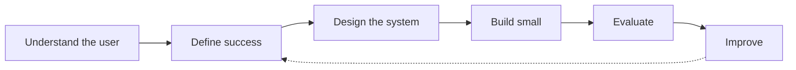
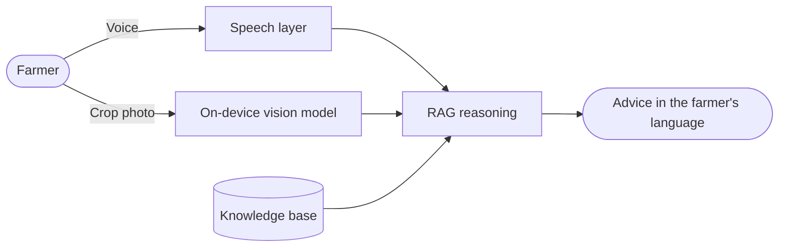

<!-- Replace every YOUR_GITHUB_USERNAME before publishing -->

<div align="center">


<br/>

[](https://www.linkedin.com/in/saim-p-127834320)
[](https://github.com/YOUR_GITHUB_USERNAME)

</div>

---

## 🧭 Account Overview

```yaml
name: Saim Patel
role: B.Tech CSE (AI) student, Class of 2030
location: India
focus:
  - Agentic AI and the Model Context Protocol (MCP)
  - Applied machine learning for real-world constraints
  - AI system design and responsible AI
approach: "Start with the user, design the architecture, then build"
```

I'm an AI-focused computer science student who likes taking an idea from **problem to plan to product**. My interests sit where machine learning, system design and user experience meet.

---

## 🧩 How I Engineer

> A model is only one part of a product. These are the questions I want every build to answer.

| Principle | The question I ask |
|---|---|
| 🎯 **Problem first** | Who is this for, and does it need AI at all? |
| 📶 **Real-world constraints** | What happens with a weak network or a low-end device? |
| 📏 **Measure before trusting** | How will we know the model works, and where does it fail? |
| 🛡️ **Safety by design** | What should the system never be allowed to do? |
| ⚖️ **Responsible AI** | Who could be harmed by bias, privacy gaps or a wrong answer? |
| 📝 **Clear documentation** | Can someone else understand why each decision was made? |



---

## 🚀 Featured Work

### 🌾 AgriMitra AI: crop advisory for smallholder farmers
`AI internship capstone` · `System design and technical plan`

A concept for a **voice-first, multilingual** advisory platform for Indian farmers, taken from strategy to a full technical blueprint.

- **Designed:** user scenarios, system architecture and an 18-month rollout roadmap
- **Model plan:** MobileNetV3-Large with TensorFlow Lite for offline diagnosis, plus an evaluation framework
- **Planned stack:** LangChain + FAISS (RAG) · FastAPI · Whisper / IndicTTS
- **Responsible AI:** analysis of privacy, bias and accountability



### 🧠 OptiBrain Focus: EEG eyewear
`Team project` · `Design Head`

Leading the design side of a dual-segment EEG eyewear concept, including presenting its design architecture.

---

## 🛠️ Toolbox

<sub>Technologies I'm learning, building with, or have designed systems around.</sub>

**Languages and web**


**AI, backend and workflow**


---

## 💼 Experience

| Role / Program | What I worked on |
|---|---|
| **AI Innovation Intern**, Yuva Intern (1 month) | AI model and prompt work, research, product-focused tasks, documentation and collaboration |
| **GenAI Powered Data Analytics**, Tata job simulation via Forage | Virtual job simulation in GenAI-assisted data analytics |
| **Fundraiser**, HelpAge India (Jul 2023 to Jun 2025) | Volunteer fundraising |

---

## 🏅 Certifications

| Certification | Issued |
|---|---|
| **Oracle Agentic AI Foundations Associate** (1Z0-1157-26) | Aug 2026 (valid to Aug 2028) |
| **Introduction to Data Science and AI**, IIT Madras | Aug 2025 |

---

## 🎯 Current Roadmap

- [ ] Build a database **MCP server** with safety guardrails
- [ ] Go deep on **transformers**, their bottlenecks, and alternatives such as Mamba and RetNet
- [ ] Publish my work with clear docs and live demos

---

## ♟️ Beyond the Code

Chess for strategy, badminton for reflexes. I also helped found a campus sports and games club and get it officially recognized.

<!--
## 📈 GitHub Activity
Remove these comment markers once you have a few weeks of regular commits.

<div align="center">
  
</div>
-->

---

<div align="center">

### 🤝 Open to AI, ML and software internships and collaborations

**Have a real problem worth solving? [Let's talk.](https://www.linkedin.com/in/saim-p-127834320)**


</div>
